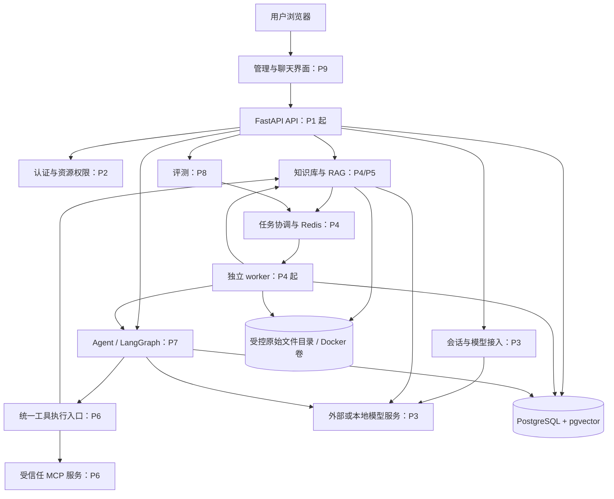

# AgentHub 架构设计

最后更新：2026-11-10。文档状态：**P1 基础运行架构与 P2 身份/持久化已实现；AI 业务模块仍为目标设计**。

## 一、当前架构事实

当前已有 `src/agenthub` 基础 API、配置、请求上下文、JSON 日志、错误处理、健康/就绪探针及 P2 身份、用户管理、审计、SQLAlchemy 会话和 Alembic 迁移。已有角色/用户/登录会话/审计四张表，没有 AI 业务模型、worker 或前端。P1 运行与恢复证据仍保留；P2 证据见 [验收记录](acceptance/P2_2026-11-10.md)。

实际调用链：Uvicorn → `create_app()` → lifespan 创建探针并检查依赖 → 请求中间件设置 ID → health 路由 → live 直接响应，ready 通过 Depends 取得 DependencyChecks → PostgreSQL 只读查询/vector 扩展检查与 Redis PING → JSON 响应和请求日志。退出时关闭 Redis 连接池，数据库连接在探针结束时关闭。详细入口和执行顺序见 [基础模块](modules/FOUNDATION.md)。

身份调用链：`/api/v1` 路由 → 输入模型/身份依赖 → identity 服务 → 每请求 SQLAlchemy Session → psycopg → PostgreSQL；密码以 Argon2id 保存，随机令牌只存摘要；管理变更与审计显式提交同一事务。引擎在 lifespan 创建，退出时 dispose；不在启动时自动迁移。同步 def 业务路由由 FastAPI 线程池执行，Redis 不参与本阶段认证。详见 [身份模块](modules/IDENTITY.md) 与 [数据库](DATABASE.md)。

以下 AI 业务总体设计与业务数据流仍为后续方案；不能将基础身份完成等同于知识库/Agent 链路完成。

首版范围：本地 Docker 部署、单组织使用；在单组织内提供多用户与基础权限。完整范围与阶段出口见 [开发计划](DEVELOPMENT_PLAN.md)。

## 二、总体设计

采用模块化单体：业务代码保存在同一项目，按职责划分模块；API 与后台 worker 分进程运行。这样既便于学习和调试，也能让耗时入库/评测不占用请求进程。未来只有在出现明确伸缩或维护需求时才拆分服务。



图中箭头表示逻辑依赖，不规定每次调用都经过网络。Agent 短请求与长期运行如何在 API/worker 间分配，在 P7 按取消、恢复与事件流需求细化。

## 三、模块职责与边界

| 模块 | 计划职责 | 主要依赖 | 阶段 |
| --- | --- | --- | --- |
| core | 配置、日志、请求 ID、错误处理、生命周期 | 运行环境 | P1 |
| db | 引擎、会话、事务约定和迁移 | PostgreSQL、SQLAlchemy、Alembic | P2 |
| identity | 登录、当前用户、角色和授权策略 | db | P2 |
| models | 生成/Embedding 适配、超时与用量 | 受控配置、真实模型服务 | P3 |
| conversations | 会话和消息、流式事件约定 | identity、db、models | P3 |
| knowledge | 知识库、文件、解析、分块与索引任务 | identity、db、models、jobs | P4 |
| rag | 权限过滤、召回、上下文与引用 | knowledge、models、conversations | P5 |
| tools / mcp | 工具注册、schema、权限、执行审计与协议适配 | identity、db、外部 MCP 服务 | P6 |
| agents / workflows | Agent 配置、图状态、运行与步骤、审批恢复 | models、rag、tools、LangGraph、db | P7 |
| evaluations | 评测集、批量执行、评分与结果对比 | rag、agents、jobs、db | P8 |
| jobs | 队列适配、任务状态、幂等、重试和恢复 | Redis、db、独立 worker | P4 起 |
| web | 管理、聊天、运行追踪、评测交互 | 已授权 API | P9 |
| observability | 日志关联、指标、保留与故障定位 | 各模块上报 | P1 起，P10 完善 |

路由负责协议与请求校验，服务负责业务流程，数据访问封装实际查询与事务需要。小模块可以保持少量文件，不要求每个功能机械地拆成多层。禁止模块绕过统一工具入口执行 Agent 工具，禁止前端直连数据库或模型凭据。

## 四、实际目录与后续模块

```text
AgentHub/
  src/agenthub/
    __init__.py
    main.py
    core/
      config.py
      dependencies.py
      errors.py
      logging.py
      middleware.py
    api/
      health.py
      identity.py
    db/
      session.py
    identity/
      models.py
      schemas.py
      security.py
      dependencies.py
      service.py
      cli.py
  migrations/
    env.py
    versions/20261110_0001_identity.py
  alembic.ini
  tests/
  scripts/verify_p1.py
  docker/postgres/init-vector.sql
  docs/
  pyproject.toml
  uv.lock
  Dockerfile
  compose.yaml
  compose.test.yaml
  .env.example
```

P1 使用可安装的 `src` 包布局，P2 已加入 `db/`、`identity/` 与 `migrations/`。后续 AI 业务模块、`jobs/` 和 `web/` 尚未创建，在对应阶段按真实实现引入。具体选型见 ADR-006、009、010。

## 五、核心数据流（计划）

### 文档入库

1. API 校验身份、知识库权限、类型和大小，将原始文件写入受控目录并记录任务。
2. 通过队列交给 worker；数据库中的任务记录用于查询与失败恢复，不能只依赖 Redis 中的瞬时状态。
3. worker 解析、清洗、分块，调用固定版本的 Embedding，校验维度后写入 pgvector。
4. 记录来源位置、模型/分块版本和结果状态。重复执行以幂等规则处理，失败可重试。
5. 文档删除和重新入库与任务版本校验配合，避免迟到任务复活已删除数据。

数据库与队列的双写不能假设天然原子性；P4 需要选择可恢复投递/补偿方案并测试“已提交但未入队”的情况。文件和数据库也需要一致性检查与清理策略。

### RAG 问答

1. 校验会话与知识库权限，对问题做向量化。
2. 在授权数据范围内召回候选分块，按上下文预算选择证据。
3. 将资料与系统指令区分，调用真实生成模型，输出流式答案与可验证引用。
4. 保存回答、来源和必要耗时/用量，使失败可定位到召回或生成步骤。

权限必须进入检索条件，不能在文档进入模型上下文后才过滤展示结果。

### Agent 与工作流

1. 加载 Agent 配置和调用者的权限上下文，创建运行记录。
2. LangGraph 根据状态进入模型、检索或工具节点，依据条件边继续或结束。
3. 工具执行入口重新校验 schema、权限、预算和副作用策略；需审批的调用先暂停。
4. 将事件、步骤和持久化检查点写入对应存储，按线程和资源归属恢复。
5. 已执行的外部副作用通过幂等键/执行记录控制；检查点不等于外部操作的事务。

运行记录回答“业务发生了什么”，图检查点回答“图如何继续”。两者关联，但不互相冒充完整的对方。

### 自动化评测

固定评测集和配置版本 → worker 调用真实 RAG/Agent 服务 → 记录逐样例成功/失败与证据 → 计算明确口径的指标 → 对比报告。评测复用业务服务，避免另写一套与真实产品不同的推理链路。

## 六、存储与部署职责

- PostgreSQL：业务事实、权限、消息、任务/运行、评测及检查点；pgvector 存放与业务关联的向量。
- Redis：后台任务协调及确有需要的短期缓存，不作为业务事实的唯一来源。队列库在 P4 选择。
- 持久化文件卷：原始文档，配合数据库备份；模型不默认随平台容器运行。
- API：请求校验、业务入口、状态查询与事件流。
- worker：文档处理、批量评测及需要后台执行的工作流；故障与重试必须可追踪。
- Web：仅通过 API 操作，凭据与授权由后端控制；具体技术在 P9 决定。

首版使用 Compose，数据库和 Redis 通过内部网络连接。P1 提供启动骨架，P10 验证完整服务的备份、恢复、升级与故障处理。

## 七、当前限制与后续演进

P1 已通过本地单元/接口、真实 TCP、容器与真实依赖、依赖恢复及保留卷重建验收，证据见 [P1 记录](acceptance/P1_2026-11-09.md)。P2 已验证身份持久化、基础授权、迁移和事务；AI 业务架构、性能、多租户与完整产品链路尚未验证。现有接口契约见 [API 文档](API_DESIGN.md)。

单组织不等于不做授权；未来多租户需要重新设计和验证数据库、检索、缓存、队列、文件及检查点的隔离边界，不能仅添加一个 tenant_id 字段就宣称完成。

设计依据及取舍见 [技术决策](TECH_DECISIONS.md)，实施与验收顺序见 [开发计划](DEVELOPMENT_PLAN.md)。
