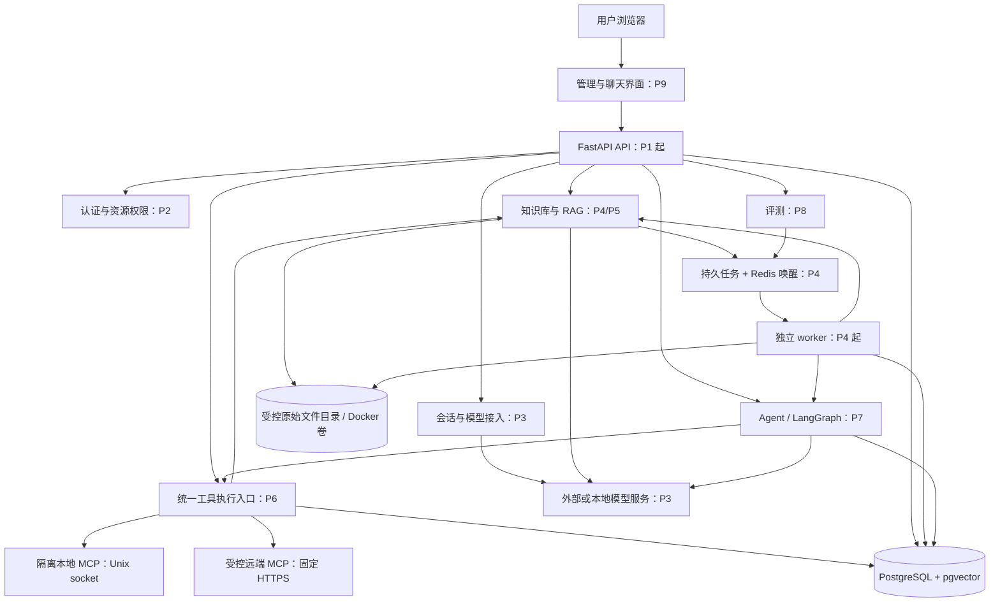

# AgentHub 架构设计

最后更新：2026-11-12。**P1—P6 已实现基础运行架构、身份、模型、文档入库、在线 RAG 与工具/MCP。** Agent、评测和前端处于后续阶段。

## 一、当前架构事实

当前已有 `src/agenthub` 基础 API、配置、请求上下文、JSON 日志、错误处理、健康/就绪探针、身份及工具管理。数据库包括身份四表、聊天三表、知识库四表、`rag_runs` 和工具三表。文档由独立 worker 处理，API 和 worker 共享原文卷。 [数据库](DATABASE.md)

实际调用链：Uvicorn → `create_app()` → lifespan 创建探针并检查依赖 → 请求中间件设置 ID → health 路由 → live 直接响应，ready 通过 Depends 取得 DependencyChecks → PostgreSQL 只读查询/vector 扩展检查与 Redis PING → JSON 响应和请求日志。退出时关闭 Redis 连接池，数据库连接在探针结束时关闭。详细入口和执行顺序见 [基础模块](modules/FOUNDATION.md)。

身份调用链：`/api/v1` 路由 → 输入模型/身份依赖 → identity 服务 → 每请求 SQLAlchemy Session → psycopg → PostgreSQL；密码以 Argon2id 保存，随机令牌只存摘要；管理变更与审计显式提交同一事务。引擎在 lifespan 创建，退出时 dispose；不在启动时自动迁移。同步 def 业务路由由 FastAPI 线程池执行，Redis 不参与本阶段认证。详见 [身份模块](modules/IDENTITY.md) 与 [数据库](DATABASE.md)。

以下设计中，文档入库、在线 RAG 与工具执行已实现。Agent 与评测为后续方案，各阶段以项目状态为准。

首版范围：本地 Docker 部署、单组织使用；在单组织内提供多用户与基础权限。完整范围与阶段出口见 [开发计划](DEVELOPMENT_PLAN.md)。

## 二、总体设计

采用模块化单体：业务代码保存在同一项目，按职责划分模块；API 与后台 worker 分进程运行。这样既便于学习和调试，也能让耗时入库/评测不占用请求进程。未来只有在出现明确伸缩或维护需求时才拆分服务。



图中箭头表示逻辑依赖，不规定每次调用都经过网络。Agent 短请求与长期运行如何在 API/worker 间分配，在 P7 按取消、恢复与事件流需求细化。

## 三、模块职责与边界

| 模块 | 计划职责 | 主要依赖 | 阶段 |
| --- | --- | --- | --- |
| core | 配置、日志、请求 ID、错误处理、生命周期 | 运行环境 | P1 |
| db | 引擎、会话、事务约定和迁移 | PostgreSQL、SQLAlchemy、Alembic | P2 |
| identity | 登录、当前用户、角色和授权策略 | db | P2 |
| models | 生成/Embedding 适配、超时与用量 | 受控配置、真实模型服务 | P3 |
| conversations | 会话和消息、流式事件约定 | identity、db、models | P3 |
| knowledge | 知识库、文件、解析、分块与索引任务 | identity、db、models、jobs | P4 |
| rag | 权限过滤、召回、上下文与引用 | knowledge、embeddings、chat、db | P5 已实现 |
| tools / mcp | 工具注册、schema、权限、执行审计与协议适配 | identity、db、RAG、MCP 服务 | P6 已实现 |
| agents / workflows | Agent 配置、图状态、运行与步骤、审批恢复 | models、rag、tools、LangGraph、db | P7 |
| evaluations | 评测集、批量执行、评分与结果对比 | rag、agents、jobs、db | P8 |
| knowledge/worker、queue | 入库领取/状态、幂等、显式重试和中断回收 | redis-py、db、独立 worker | P4 已实现 |
| web | 管理、聊天、运行追踪、评测交互 | 已授权 API | P9 |
| observability | 日志关联、指标、保留与故障定位 | 各模块上报 | P1 起，P10 完善 |

路由负责协议与请求校验，服务负责业务流程，数据访问封装实际查询与事务需要。小模块可以保持少量文件，不要求每个功能机械地拆成多层。禁止模块绕过统一工具入口执行 Agent 工具，禁止前端直连数据库或模型凭据。

## 四、P2 目录基线与后续模块

```text
AgentHub/
  src/agenthub/
    __init__.py
    main.py
    core/
      config.py
      dependencies.py
      errors.py
      logging.py
      middleware.py
    api/
      health.py
      identity.py
    db/
      session.py
    identity/
      models.py
      schemas.py
      security.py
      dependencies.py
      service.py
      cli.py
  migrations/
    env.py
    versions/20261110_0001_identity.py
  alembic.ini
  tests/
  scripts/verify_p1.py
  docker/postgres/init-vector.sql
  docs/
  pyproject.toml
  uv.lock
  Dockerfile
  compose.yaml
  compose.test.yaml
  .env.example
```

P1 使用可安装的 `src` 包布局，P2 已加入 `db/`、`identity/` 与 `migrations/`。P3 已加入 chat/embeddings/api/chat，P4 已加入 knowledge/（含 worker/queue）和 api/knowledge、0003迁移及测试；没有单独 jobs 包。web 尚未创建。上面的树保留 P2 目录基线，不代表全部当前文件。具体选型见 ADR-006、009、010。

## 五、核心数据流

### 文档入库

1. API 校验身份、知识库权限、类型和大小，将原始文件写入受控目录并记录任务。
2. 数据库事务持久化 queued 任务，Redis 只唤醒 worker；worker 周期扫描数据库并用 SKIP LOCKED 领取。
3. worker 解析、清洗、分块，调用固定版本的 Embedding，校验维度后写入 pgvector。
4. 记录来源位置、模型/分块版本和结果状态。重复执行以幂等规则处理，失败可重试。
5. 文档删除和重新入库与任务版本校验配合，避免迟到任务复活已删除数据。

数据库与队列的双写不能假设天然原子性；P4 已选择持久任务扫描加 Redis 唤醒，测试已提交但 Redis 不可用时仍可处理。文件通过 UUID、摘要、墓碑和一小时孤儿回收补偿；租约过期明确失败并由用户显式重试。

### RAG 问答

1. `api/rag.py` 校验知识库所有权和模型空间。问答还校验会话所有权，在短事务中占用与普通聊天共用的会话租约，创建待完成消息和 `rag_runs`。
2. `EmbeddingProvider` 向量化问题。`rag/retrieval.py` 以 pgvector 余弦距离做精确 Top-K。SQL 同时约束知识库、用户、可见状态、已发布版本与模型空间。纯检索到此返回。
3. 以实际序列化字符数选择完整证据，编号后作为 JSON 数据交给生成模型。无合格证据时直接返回。输出中的引用必须与本轮上下文匹配。
4. 收尾事务按会话、知识库顺序加锁，复查所有输入证据并保存答案与引用。JSON 成功或 SSE `done` 在提交后发送。SSE 增量为草稿，失败时丢弃。Embedding 和生成期间均释放数据库连接与锁。

### 工具与 MCP

1. HTTP 身份依赖确定调用者，`tools.executor` 读取版本及权限，提交调用审计。查询、锁和连接到此结束。
2. 验证输入，调用内置处理器或 MCP。私有知识库检索复用 `rag/search.py`，网络适配重新发现并验证登记摘要。
3. 校验输出并用短事务提交审计终态。调用者通过请求 ID 关联失败；外部服务停机时业务 API 仍可检查 PostgreSQL 和 Redis。

### Agent 与工作流（P7 计划）

1. 加载 Agent 配置和调用者的权限上下文，创建运行记录。
2. LangGraph 根据状态进入模型、检索或工具节点，依据条件边继续或结束。
3. 工具执行入口重新校验 schema、权限、预算和副作用策略；需审批的调用先暂停。
4. 将事件、步骤和持久化检查点写入对应存储，按线程和资源归属恢复。
5. 已执行的外部副作用通过幂等键/执行记录控制；检查点不等于外部操作的事务。

运行记录回答“业务发生了什么”，图检查点回答“图如何继续”。两者关联，但不互相冒充完整的对方。

### 自动化评测

固定评测集和配置版本 → worker 调用真实 RAG/Agent 服务 → 记录逐样例成功/失败与证据 → 计算明确口径的指标 → 对比报告。评测复用业务服务，避免另写一套与真实产品不同的推理链路。

## 六、存储与部署职责

- PostgreSQL：业务事实、权限、消息、任务/运行、评测及检查点；pgvector 存放与业务关联的向量。
- Redis：后台任务协调及确有需要的短期缓存，不作为业务事实的唯一来源。P4 复用 redis-py 唤醒列表，PostgreSQL 负责任务持久化/领取。
- 持久化文件卷：原始文档，配合数据库备份；模型不默认随平台容器运行。
- API：请求校验、业务入口、状态查询与事件流。
- worker：文档处理、批量评测及需要后台执行的工作流；故障与重试必须可追踪。
- Web：仅通过 API 操作，凭据与授权由后端控制；具体技术在 P9 决定。

首版使用 Compose，数据库和 Redis 通过内部网络连接。P1 提供启动骨架，P10 验证完整服务的备份、恢复、升级与故障处理。

## 七、当前限制与后续演进

P1 已通过本地单元/接口、真实 TCP、容器与真实依赖、依赖恢复及保留卷重建验收。P2—P5 已验证身份、模型、文档入库及三类固定样本的检索问答。大规模检索性能、Agent、多租户与完整产品验收仍属后续工作。现有接口契约和验证范围见 [API 文档](API_DESIGN.md)、[P5 验收](acceptance/P5_2026-11-12.md)。

单组织不等于不做授权；未来多租户需要重新设计和验证数据库、检索、缓存、队列、文件及检查点的隔离边界，不能仅添加一个 tenant_id 字段就宣称完成。

设计依据及取舍见 [技术决策](TECH_DECISIONS.md)，实施与验收顺序见 [开发计划](DEVELOPMENT_PLAN.md)。

## P3 当前执行链路

认证依赖 → chat 路由 → service.prepare 在线程池的短事务中锁会话行、查所有权、检查租约、插入消息与调用记录 → 提交并释放连接 → ChatProvider 通过应用生命周期内共享的 httpx2.AsyncClient 调用管理员配置的 `/chat/completions` → 普通 JSON 或 start/delta SSE → service.finish 短事务保存内容/状态/用量 → done/error。

数据库阻塞操作进入线程池；外部 HTTP 使用异步 I/O。网络等待不持有数据库锁或连接。会话租约为模型总超时 + 30 秒，后续发送可将过期 pending 标记为 generation_interrupted；迟到的旧生成不能清除新租约。取消时使用 shield 保护短暂收尾事务。进程硬退出无法执行 finally，依靠租约恢复；没有后台 worker 自动续跑。详见 [模块](modules/CHAT.md)。

## P3 Embedding 内部接线

lifespan 创建 `app.state.embedding_provider`，复用应用异步 HTTP 客户端，Embedding 请求使用独立 key，地址限定百炼北京业务空间。适配器经有界 HTTP、整批校验和 L2 归一化返回向量。P4 worker 用于文档入库，P5 RAG 用于问题向量化。URL 或密钥空缺时调用返回 `embedding_not_configured`。健康检查只访问基础设施。

Embedding 的上游 403 insufficient_quota 现在映射为内部 AppError 503 embedding_quota_exhausted，其余403仍为通用上游错误；无需改变公开 API、数据流或数据库结构。

## P4 实际离线链路

Bearer/所有权 → multipart有界上传 → UUID原文件 + 文档/任务事务 → Redis唤醒（可失败） → 独立worker数据库领取/租约 → 摘要校验/限时子进程解析 → 页内字符分块 → 固定空间Embedding分批调用 → 每批短事务校验/续租/用量 → 全部分块单事务发布ready。网络与解析不持有数据库事务。

删除与发布统一按KB→document→job锁定；墓碑/版本/状态/租约阻止迟到发布。API/worker以UID999共享document_data；物理文件删除和一小时孤儿回收由worker补偿。具体限制、代码入口与替代方案见 [知识模块](modules/KNOWLEDGE.md)、[任务模块](modules/JOBS.md)。
